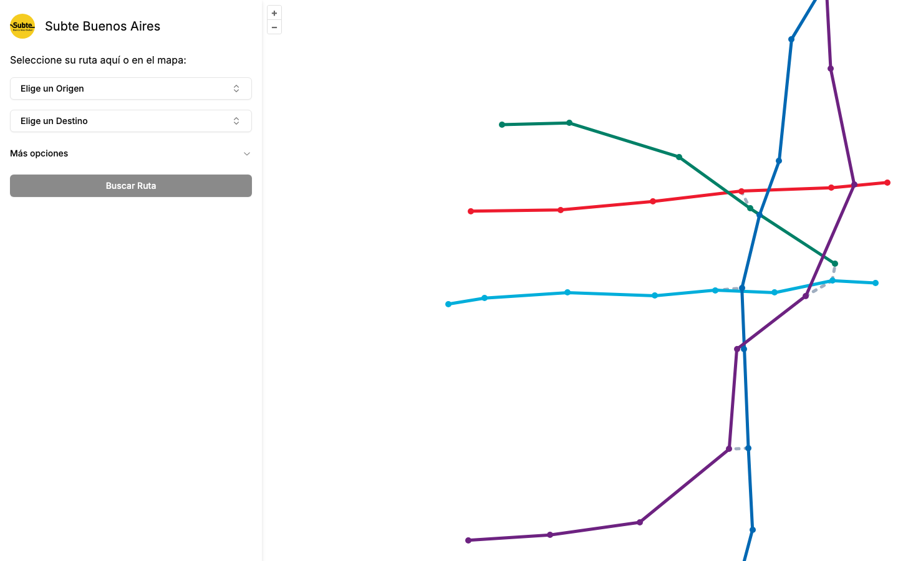

# Metro route planner: web app

University project (UPM, 2024). Web app to plan trips on the Buenos Aires Subte: pick two stations, a day and a time, and get the fastest route with departure times, transfers and arrival time, drawn on a map.

**Live:** [appmetro.vercel.app](https://appmetro.vercel.app) · **API:** [python-metro-api](https://github.com/SergioMedinaH/python-metro-api)



## Features

- Route search with A* on the backend (see [python-metro-api](https://github.com/SergioMedinaH/python-metro-api)).
- Interactive map with OpenLayers: stations, lines and the selected route.
- Day and time pickers; the itinerary uses the weekday, Saturday or Sunday timetable.
- Step-by-step itinerary per line: direction, waiting time, departure and arrival, transfers.
- Accessibility at origin and destination (stairs, escalators, lifts).
- Warns when the network is closed at the selected time.

## Stack

Next.js · React · TypeScript · Tailwind CSS · shadcn/ui · OpenLayers · Vercel

## Run locally

```bash
npm install
npm run dev
```
